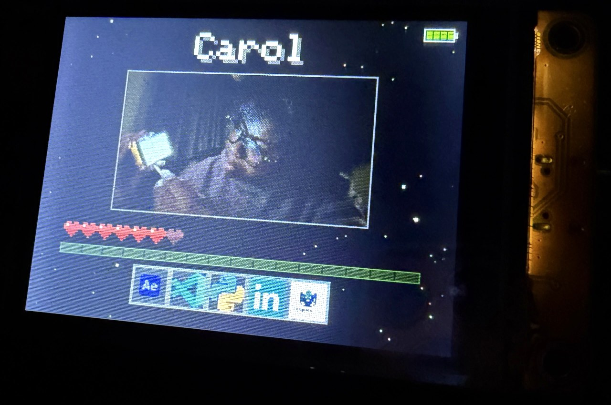
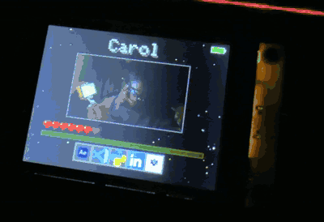
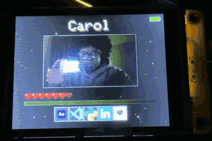
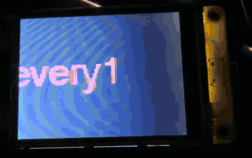
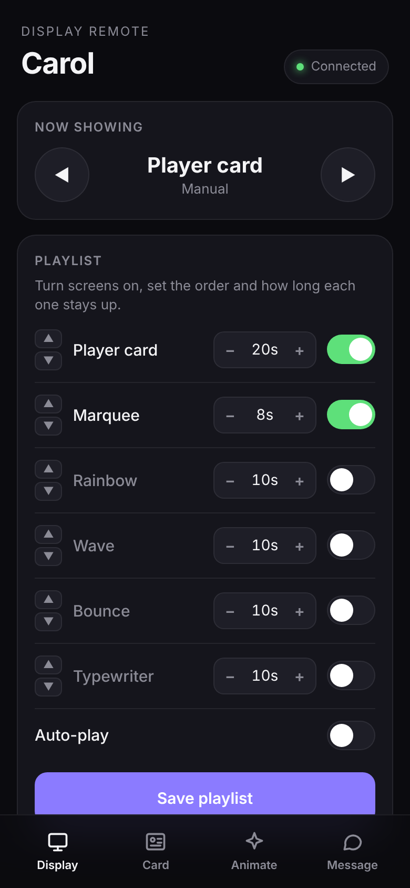
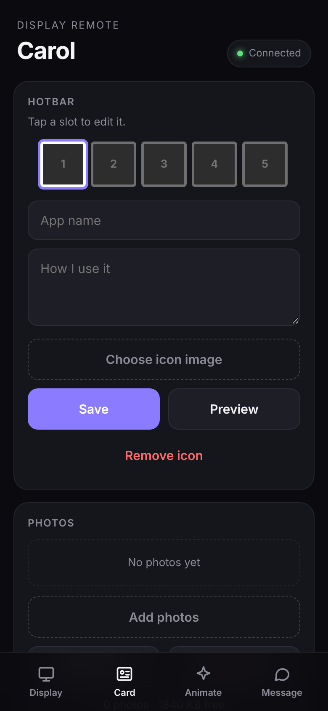

# ESP32 Player Card

A tiny Minecraft-inspired **portfolio display** I built on an ESP32 touchscreen. It shows a "player card" about me (a glowing pixel name, a looping photo, hearts, an XP bar and a hotbar of the tools I use), and I control everything from my phone.

## In action

**Tapping through the hotbar.** Each slot opens a card about how I use that app.

**Coming online.** Once Wi-Fi connects, the board gets the time and the level number and XP bar fill in.

**Username animation (Marquee).** My username scrolls across the screen in shifting colours.

Full-quality videos: [hotbar](docs/hotbar.mp4) · [coming online](docs/boot-wifi.mp4) · [marquee](docs/marquee.mp4)

## Features

**On the display**
- **Glowing pixel name** at the top, with a drop shadow
- **Photo "GIF"**: a few photos that loop slowly in the frame
- **Hearts**: 6 of 7 full
- **XP bar + level**: the level is my age and the bar fills up toward my next birthday, using the time from the internet
- **Hotbar**: five slots with app icons. Tap a slot to open a tooltip-style card about how I use that app
- **Twinkling stars** in the background and a **battery indicator** in the corner
- **Five username animations**: Rainbow, Wave, Bounce, Typewriter, Marquee

**On the phone remote** (served by the board itself, no app to install)
- **Now showing**, with previous / next
- **Playlist**: pick which screens play, their order and how long each stays up, with optional auto-play
- **Hotbar editor**: upload icons and write each app's description
- **Photos**: upload from the camera roll (resized on the phone before sending)
- **Message**: pop a message up on the display

| Display tab | Card tab |
|---|---|
|  |  |

## Hardware

- **Freenove ESP32 Display, FNK0114B** (2.8" ST7789, 320×240, resistive touch, CH340 USB)
- USB cable that carries data. Optional: a 3.7 V lithium battery or a power bank

## Setup

1. **USB driver**: install the **CH340** driver (included in Freenove's download, in the `CH340` folder).
2. **Arduino IDE 2** with the **esp32 by Espressif Systems** board package.
   Board manager URL: `https://espressif.github.io/arduino-esp32/package_esp32_index.json`
3. **Libraries**: install the ones from Freenove's `Libraries/FNK0114B_2.8inch_ST7789` folder
   (`TFT_eSPI`, `TFT_eSPI_Setups`, `TFT_Touch`, `TJpg_Decoder`). Use Freenove's copy of TFT_eSPI and don't update it.
   In `TFT_eSPI/User_Setup_Select.h`, make sure the **FNK0114B** setup line is the active one.
4. **Your details**: in the `Mini_Portfolio` folder, copy `secrets.example.h` to **`secrets.h`** and fill in your Wi-Fi and birthday.
   `secrets.h` is in `.gitignore`, so it stays on your computer.
5. In Arduino IDE, choose:
   - **Board:** ESP32 Dev Module
   - **Partition Scheme:** No OTA (2MB APP/2MB SPIFFS), which leaves room to store photos and icons
   - **Port:** the CH340 COM port
6. Open `Mini_Portfolio/Mini_Portfolio.ino` and upload.

Then open the board's address (shown in the Serial Monitor at 115200 baud) in your phone's browser. The phone and board need to be on the **same 2.4 GHz network**. For an iPhone hotspot, turn on **Maximize Compatibility**(this will not work if you dont do this).

## Customising

Most settings are `#define`s near the top of the sketch:

| Setting | What it does |
|---|---|
| `TAG_TEXT` | The name on the card |
| `HEARTS_FULL` / `HEARTS_TOTAL` | Hearts row |
| `FRAME_MS` | How long each photo stays up |
| `NAME_GLOW_MS` | Speed of the name glow |
| `NUM_STARS` | How many stars twinkle |
| `tft.invertDisplay(false)` in `setup()` | Colour fix for panels that show a "photo negative" |

## Troubleshooting

- **Colours look inverted** (white background, cyan hearts): flip the value in `tft.invertDisplay(false)`.
- **"redefinition of …" errors**: keep only **one `.ino` file** in the sketch folder. Arduino merges every `.ino` file in a folder.
- **Stuck on "Connecting to Wi-Fi…"**: the ESP32 only sees 2.4 GHz networks. Check the name and password in `secrets.h`. After about 20 seconds it shows the card anyway.
- **XP bar empty**: it needs internet time, so connect to Wi-Fi.
- **Grey dash on the battery icon**: no battery detected. That's normal on USB or a power bank.

## Credits

- Board, drivers and display setups: [Freenove](https://github.com/Freenove/Freenove_ESP32_Display)
- [TFT_eSPI](https://github.com/Bodmer/TFT_eSPI) and [TJpg_Decoder](https://github.com/Bodmer/TJpg_Decoder) by Bodmer, and TFT_Touch
- MANYYY youtube videos if i listed all the channels you'`d be here forever...
- Claude helped when I had no idea what was going on

The hearts, XP bar and hotbar are my own pixel art in a Minecraft-inspired style. This project isn't affiliated with Mojang or Microsoft AT ALL.
